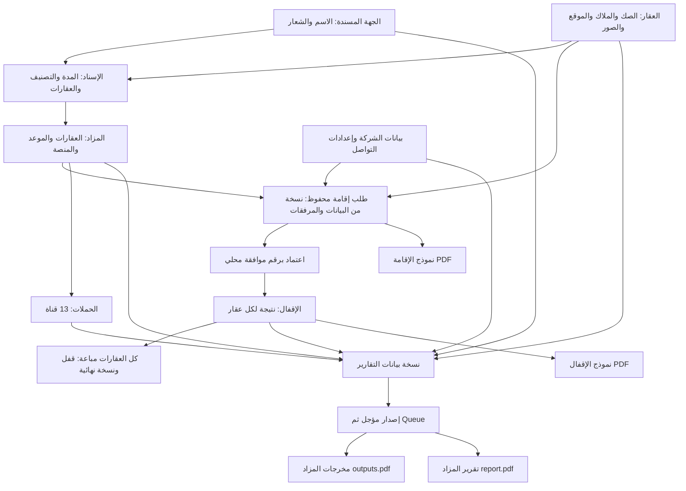

# مرجع دورة المزاد وخطة الاختبار الشامل

تاريخ المراجعة: **11 نوفمبر 2026**. المرجع البرمجي عند التحقق الأخير: `44d29fb6`؛ شملت القراءة تعديلات الواجهات المحلية الموجودة في بداية المراجعة. هذا وصف للسلوك الحالي من الكود، وليس اعتمادًا لصحة كل قاعدة عمل أو إعلانًا باجتياز الاختبار الشامل. حالات الاختبار أدناه مقترحة؛ نتيجة تنفيذها غير معلومة إلا حيث وردت في سجل التشغيل.

الغرض: الاحتفاظ بفهم قابل للرجوع إليه للإسنادات والجهات المسندة والعقارات والمزادات وطلبات الإقامة والإقفال والحملات والتقارير؛ ثم تحويل السيناريوهات إلى اختبارات تثبت السلوك وتعيد إنتاج المشاكل قبل إصلاحها. لم تتغير ملفات التطبيق في هذه المراجعة.

## 1. خريطة النظام ومصادر الحقيقة



| المجال                  | المصدر الفعلي                                                                               | أين يبدأ تتبع الكود                                                           |
| ----------------------- | ------------------------------------------------------------------------------------------- | ----------------------------------------------------------------------------- |
| الجهات المسندة          | `issuing_entities`                                                                          | `app/Services/Tenants/Assignments/IssuingEntityService.php:26`                |
| الإسنادات               | `assignments`، وربط العقارات عبر `properties.assignment_id`                                 | `app/Actions/Tenants/Assignments/CreateAssignmentAction.php:32`               |
| المزاد وعقاراته         | `auctions` و`auction_properties`                                                            | `app/Models/Tenants/Auctions/Auction.php:69`                                  |
| نتيجة بيع العقار        | حقول pivot داخل `auction_properties`؛ وحالة تشغيلية مكررة في `properties.status`            | `app/Actions/Tenants/AuctionClosings/SaveAuctionClosingAction.php:44`         |
| الحملات والأدلة         | `auction_marketing_campaigns` و`auction_attachments`                                        | `app/Actions/Tenants/MarketingCampaigns/SaveMarketingCampaignAction.php:21`   |
| طلب الإقامة             | سجل واحد لكل مزاد، `data` محفوظة ومرفقات خاصة وبيانات الاعتماد                              | `app/Models/Tenants/AuctionEstablishments/AuctionEstablishmentRequest.php:23` |
| الإقفال                 | سجل واحد لكل مزاد، و`finalized_snapshot` عند بيع الجميع                                     | `app/Actions/Tenants/AuctionClosings/SaveAuctionClosingAction.php:75`         |
| تقريرا المزاد           | `auction_report_generations`، والإصدار المنشور في `auctions.published_report_generation_id` | `app/Services/Tenants/Auctions/Reports/AuctionReportService.php:20`           |
| نموذجا الإقامة والإقفال | `auction_form_generations`، نوع مستقل لكل نموذج                                             | `app/Services/Tenants/Auctions/Forms/AuctionRegulatoryFormService.php:21`     |

مسارات العمل الفعلية موجودة في `routes/tenant.php:260` للإسنادات، `:273` للجهات، `:285` للعقارات، و`:298` حتى `:325` للمزادات والتقارير والنماذج والإقامة والإقفال والحملات. أرشيف الإسنادات والعقارات والمزادات له مسارات منفصلة ابتداءً من `:395`.

التقارير الأصلية تعمل بمسار native داخل `Reports`، ويجب فصلها عن مسار قوالب الإعلانات الترويجية القديم. مسارات إدارة قوالب المزادات في `routes/admin.php:177` معلقة حاليًا؛ وجود فئة أو اختبار قديم لا يثبت أن الميزة متاحة من واجهة المستخدم.

## 2. الحالات: خمس مجموعات مختلفة

| المجموعة               | القاعدة الحالية                                                                          | ما لا تعنيه                                                  |
| ---------------------- | ---------------------------------------------------------------------------------------- | ------------------------------------------------------------ |
| حالة المزاد            | `pending` بدون اعتماد؛ `approved` باعتماد؛ `closed` عندما توجد عقارات وكل نتائجها `sold` | انتهاء الموعد أو تغيير `is_active` لا يعتمد المزاد ولا يقفله |
| حالة طلب الإقامة       | لا يوجد طلب / `under_review` / `approved`                                                | حفظ الطلب لا يعني اعتماده                                    |
| حالة الإقفال المعروضة  | لم يبدأ / محفوظ / منتهي                                                                  | حفظ نتائج مختلطة أو كلها غير مباعة لا ينهي المزاد            |
| اكتمال بيانات التقارير | اكتمال حملات التسويق وفق قواعد القنوات الـ13                                             | لا يشترط الإقفال أو نجاح PDF                                 |
| جاهزية الملف           | لا إصدار / `queued` / `processing` / `ready` / `failed` / `superseded`                   | وجود نسخة جديدة غير جاهزة لا يمحو النسخة المنشورة السليمة    |

المراجع: `Auction.php:188` و`:227`؛ `AuctionEstablishmentRequest.php:23`؛ `AuctionClosingsDataTable.php:203`؛ `AuctionReportState.php:12`؛ `AuctionMarketingCompleteness.php:12`.

تفاصيل مؤثرة في الاختبارات:

-   شرط الإقفال يسبق شرط الاعتماد: المزاد التاريخي الذي كل عقاراته مباعة يُعتبر مقفلًا حتى بدون سجل طلب إقامة أو سجل إقفال.
-   المزاد بلا عقارات لا يُقفل تلقائيًا؛ مع اعتماد تاريخي يمكن أن تكون حالته `approved`، لكن المسار العادي يمنع اعتماد طلب بلا عقارات.
-   سجل إقفال قديم فيه `finalized_snapshot` يقفل التعديل أيضًا، حتى لو تغيرت النتائج التاريخية فلم تعد الحالة المحسوبة `closed`.
-   يمكن وجود مزاد مقفل وتسويقه غير مكتمل؛ سيناريو التجربة `WF-08` مصمم لهذا الفصل.
-   endpoint تغيير حالة المزاد اليدوي ما زال موجودًا لكنه يرفض التغيير برسالة validation.

## 3. الجهات المسندة والإسنادات والعقارات

### الجهات المسندة

-   الاسم فريد بين السجلات غير المحذوفة، بطول 2–255، والصورة اختيارية حتى 10 MB، مع `is_active` اختياري.
-   تغيير الاسم يحدث النص المكرر `assignments.issuing_entity` بجانب المفتاح الأجنبي. تغيير الشعار يستدعي تحديث تقارير المزادات التابعة؛ فرع تغيير الاسم لا يستدعي نفس التحديث.
-   الحذف وتبديل الحالة ممنوعان عند وجود إسنادات غير محذوفة. التبديل يمنع حتى طلب إعادة نفس الحالة إذا كانت الجهة مرتبطة.
-   الإنشاء والتعديل داخل transactions، لكن حذف الصورة القديمة في بعض مسارات الاستبدال يسبق commit؛ يلزم اختبار rollback للملفات.

المراجع: `StoreIssuingEntityRequest.php:17`، `UpdateIssuingEntityRequest.php:25`، `IssuingEntityService.php:45` و`:73` و`:88`، تحت مسارات `app/Http/Requests/Tenants/IssuingEntities` و`app/Services/Tenants/Assignments`.

### الإسنادات

-   الإنشاء يتطلب رقمًا فريدًا، اسمًا، جهة مسندة بمعرف أو نص، مدينة، تصنيفًا، تاريخي بداية ونهاية، وعقارًا واحدًا على الأقل غير مرتبط بإسناد وغير محذوف.
-   ملفات الإنشاء المطلوبة: صورة، خطاب PDF، ومرفق عام واحد على الأقل؛ الحد لكل ملف 10 MB. ملفات التعديل اختيارية.
-   في الإدخال النصي للجهة، `prepareForValidation()` يبحث عنها أو ينشئها **قبل** اكتمال validation وقبل transaction الإسناد؛ هذه نقطة اختبار للصلاحيات والآثار الجانبية للطلبات المرفوضة.
-   الإنشاء يقفل العقارات المحددة ويتحقق من عددها ثم يربطها. التعديل يقفل الإسناد والعقارات ويرفض الاستيلاء على عقار بإسناد آخر.
-   لا يمكن إضافة/فك عقار عند تغيير العضوية إذا له أي pivot مزاد، حتى لو المزاد مؤرشف. إبقاء العضوية القائمة مسموح.
-   حذف الإسناد العادي والنهائي ممنوع مع وجود عقارات أو مزادات، بما فيها المحذوفة منطقيًا. الاستعادة تستعيد سجل الإسناد فقط.
-   تعطيل الإسناد لا يعطل المزادات المرتبطة تلقائيًا.

المراجع: `StoreAssignmentRequest.php:20` و`:45`، `UpdateAssignmentRequest.php:45`، `CreateAssignmentAction.php:84`، `UpdateAssignmentAction.php:120` و`:144`، `AssignmentService.php:86` و`:96`، داخل مجلدات `Tenants/Assignments`.

### التصنيف والجاهزية

-   التصنيفات الخمسة: سكني، تجاري، زراعي، صناعي، متعدد الاستخدامات.
-   توافق الاستخدام يعني نفس التصنيف أو `other`. نوع البناء/العقار مستقل؛ جميع أنواع العقار مسموحة في دوال توافق النوع.
-   اختيار عقارات الإسناد في DataTable والواجهة يفلتر الاستخدام، لكن FormRequests وActions الإسناد لا تفرضان هذا التطابق. هذا اختلاف مثبت بين الطبقات؛ اعتباره عيب عمل يتوقف على القاعدة المطلوبة.
-   الاختيار لا يشترط اكتمال `data_status` أو نشاط العقار أو `status=available`؛ إحصاء «جاهز للإسناد» أضيق من قواعد الاختيار الفعلية.
-   تعديل العقار يمكن أن يغير استخدامه بعد ربطه بالمزاد؛ يلزم اختبار أثر ذلك على صلاحية البيانات والطلبات المعتمدة.

المراجع: `app/Enums/Tenants/Assignments/AssignmentCategory.php:32` و`:52`؛ `AssignmentPropertySelectionDataTable.php:36` و`:96`؛ `resources/assets/js/tenant/assignments/create.js:644`؛ `PropertyService.php:19`.

### بيانات العقار المؤثرة

الصك ورقمه وتاريخه والجهة، الملاك وهوياتهم، الوكيل والوكالة، المساحة والتقييم، النوع والاستخدام، المدينة والحي، الصور والوحدات: تدخل افتراضيات طلب الإقامة أو التقرير. الإنشاء يطلب ملاكًا وهويات؛ التعديل أكثر تساهلًا، ويمكن أن يحذف الملاك بإرسال مصفوفة فارغة. لا نفترض أن وجود العقار يعني اكتمال مستندات طلب الإقامة.

حذف العقار منطقيًا ممنوع مع أي مزاد غير محذوف، بصرف النظر عن نشاطه أو نتيجته. الحذف النهائي ممنوع مع أي مزاد حتى المؤرشف. تحديث العقار يطلب تجديد تقارير المزادات المفتوحة؛ التقارير النهائية محفوظة من النسخة النهائية.

المراجع: `StorePropertyRequest.php:129`، `UpdatePropertyRequest.php:138`، `UpdatePropertyAction.php:166` و`:262`، `PropertyService.php:36` و`:51`.

## 4. إنشاء المزاد وتعديله وأرشفته

الإنشاء يتطلب الاسم والوصف والمدينة والنوع والتصنيف، تاريخين ووقتين صحيحين، عددًا متوقعًا موجبًا، مدير المشروع والمنصة، إسنادًا صالحًا، وعقارًا واحدًا على الأقل. الأنواع: إلكتروني/حضوري/هجين. الصورة والمرفقات اختيارية. حاليًا الوصف والأوقات والمنصة والعدد المتوقع أكثر تساهلًا عند التعديل مقارنة بالإنشاء؛ خصوصًا أوقات التعديل ليس لها `date_format:H:i` صريح.

قواعد الإسناد والعقارات:

1. عند الإنشاء: الإسناد موجود وغير محذوف ونشط وغير منتهي؛ فترة المزاد داخل فترة الإسناد. نهاية نفس اليوم يجب أن تأتي بعد البداية.
2. عند تعديل نفس الإسناد: يُسمح بالإسناد الحالي حتى لو تعطل أو انتهى، مع بقاء قيد الفترة. الانتقال لإسناد آخر يخضع لشروط الإنشاء.
3. العقارات مميزة وغير محذوفة وتتبع الإسناد المختار؛ الاستخدام مطابق لتصنيف المزاد أو `other`.
4. FormRequest يمنع المباع سابقًا أو المرتبط بمزاد مفتوح آخر؛ فحص pivot البيع يشمل التاريخ المؤرشف.
5. بعد اعتماد الإقامة لا يمكن تغيير الإسناد أو مجموعة العقارات؛ بقية الحقول ليست كلها مقفلة بهذا الشرط.
6. نتائج البيع والحملات والأدلة ليست مدخلات مسموحة في نموذج إنشاء/تعديل المزاد؛ لها إداراتها. `marketing.introduction` استثناء مسموح.

المراجع: `StoreAuctionRequest.php:28` و`:145`، `UpdateAuctionRequest.php:28` و`:149`، `CreateAuctionAction.php:61`، `UpdateAuctionAction.php:68` و`:134`.

الأثر على حالة العقار: pending → `assigned_to_auction`، sold → `sold`، unsold → `available`. إزالة عقار من مزاد مفتوح تعيد المتاح إذا كان `assigned_to_auction`. الحذف المنطقي للمزاد يبقي pivots وحالة العقار؛ الحذف النهائي يسقط pivots بقيد FK ولا يعيد حساب حالة العقار. الاستعادة تستعيد المزاد فقط.

اختلاف مهم في الواجهة: `AssignmentsController::getProperties()` يقرر الانشغال من `auctions.is_active=true` ولا يستثني المزاد الحالي، بينما validation يستخدم `Auction::open()` ويستثني الحالي عند التعديل. الواجهة تعطل العقارات غير القابلة للاختيار ثم تعلم الحالي كمحدد دون إعادة تمكينه. يلزم إثبات الأثر في المتصفح قبل إصلاحه.

نقطة تزامن: الـAction يقفل الإسناد ويفحص ملكية العقار لكنه لا يعيد فحص البيع أو الانشغال أو التصنيف بعد القفل. وجود validation قبل transaction لا يكفي وحده لإثبات منع إنشاء مزادين متزامنين بنفس العقار.

المراجع: `AuctionReportInputService.php:18`، `AssignmentsController.php:252`، `resources/assets/js/tenant/auctions/create.js:790` و`:826`، `AuctionService.php:54`، `RestoreAuctionAction.php:11`.

## 5. طلب الإقامة والاعتماد

### الإدخال والحفظ

النموذج ست خطوات: الشركة والمسؤولون؛ بيانات المزاد وأموال الدخول؛ العقارات؛ الإفصاحات والممثل؛ المستندات؛ المراجعة والإقرار. لكل مزاد draft مستقل، ويُعاد دمج ملفاته قبل validation النهائي.

الحفظ يقفل المزاد والطلب الموجود، يرفض المقفل أو المعتمد، يعيد التحقق ويصنع نسخة بيانات مستقلة، ثم يسجل وقت التقديم والمستخدم. إعادة الحفظ قبل الاعتماد تعيد بناء النسخة وتاريخ التقديم. لا يكتب استكمال الحقول داخل الطلب إلى العقار أو إعدادات الشركة تلقائيًا.

اسم الشركة والسجل التجاري يُكتبان دائمًا من بيانات المستأجر المركزي، حتى لو كانا فارغين؛ استكمالهما من داخل الطلب لا يعوض نقص المصدر الحالي. مدير المشروع واسم المزاد وطريقته ومدته والمنصة وبيانات الصك والملاك والعقار والوكالة تتقدم على القيم المرسلة عندما تكون متاحة؛ بعض القيم الناقصة في هذه المجموعات يمكن استكمالها في الطلب. مجموعة عقارات النسخة يجب أن تساوي مجموعة عقارات المزاد بالمعرفات، دون تكرار وغير فارغة.

أهم قواعد البيانات:

-   سجل تجاري 10 أرقام، رقم موحد `700` ثم 7 أرقام، ورقم FAL رقمي.
-   المسؤولون: هوية 10 أرقام تبدأ 1 أو 2، جوال سعودي `05` ثم 8 أرقام، بريد صحيح.
-   الإلكتروني/الهجين يحتاج منصة؛ الحضوري/الهجين يحتاج مكانًا. نهاية المزاد لا تسبق البداية.
-   استلام/رد الأموال: تحويل أو شيك أو أخرى بتفصيل. مدة الاستلام 0–365، الرد 0–3 أيام.
-   المساحة موجبة، العمر 0–200، الملكية أكبر من صفر وحتى 100، مبالغ الافتتاح والدخول والتقييم غير سالبة.
-   الوكيل والوكالة مطلوبان معًا؛ الحالات «أخرى» تحتاج تفصيلًا؛ إفصاح «نعم» يحتاج توضيحًا؛ «لا يوجد» لا يجتمع مع حقوق تصرف أخرى؛ الإقرار مطلوب.
-   طلب HTTP ينظف الأرقام والفواصل. لا يقبل تزوير الاعتماد أو المستخدم أو بيانات مسارات المرفقات.

المراجع: `AuctionEstablishmentRequestData.php:17` و`:182` و`:223`؛ `SaveAuctionEstablishmentRequest.php:27` و`:79`؛ `SaveAuctionEstablishmentRequestAction.php:26`؛ `WizardFormRequest.php:12`.

### المستندات

شهادتا تدريب المدير والقائم على المزاد وصك كل عقار مطلوبة دائمًا. التقييم مطلوب عند مبلغ دخول غير صفري؛ التفويض مطلوب عند وجود وكيل. الملفات PDF/PNG/JPG/JPEG حتى 10 MB، بأسماء مولدة داخل `tenant_private` تحت مجلد يضم hash هوية المستأجر ومعرف المزاد. rollback يحذف الملفات الجديدة المتتبعة. تنزيل الملف يتحقق من الصلاحية والنوع ومسار المستأجر والمزاد ووجود الملف.

نسخة الاستبدال تحتفظ حاليًا بmetadata سابقة وتستبدل المفاتيح دون تنظيف شامل للملفات القديمة؛ اختبار الملفات اليتيمة وتغيير العقارات قبل الاعتماد مطلوب.

المراجع: `SaveAuctionEstablishmentRequestAction.php:57`، `AuctionEstablishmentRequestsController.php:56`، `resources/views/tenant/auction-establishment-requests/steps/step5-attachments.blade.php:8`.

### الاعتماد

الاعتماد يسجل رقم موافقة غير فارغ بعد trim مع الحفاظ على الأصفار في البداية، والمستخدم والتوقيت. يشترط طلبًا موجودًا غير معتمد، مزادًا غير مقفل، وتطابق معرفات العقارات الحالية مع النسخة. لا يعيد كتابة نسخة الطلب، ولا يتصل في هذا المسار بخدمة خارجية للتحقق من رقم الموافقة. لا يعيد فحص وجود كل ملف عند الاعتماد؛ هذه حالة اختبار مطلوبة.

بعد الحفظ وبعد الاعتماد يُطلب إصدار جديد من نموذج الإقامة. لا يفترض أن اعتماد الطلب يجدد تقريري المزاد تلقائيًا؛ يجب تتبع كل مخرج مستقلًا.

المراجع: `ApproveAuctionEstablishmentRequest.php:11`، `ApproveAuctionEstablishmentRequestAction.php:19`، `AuctionEstablishmentRequest.php:23`.

## 6. الحملات واكتمال التسويق

| القناة               | الحقول المطلوبة وفق الإعدادات                                         |
| -------------------- | --------------------------------------------------------------------- |
| `planning`           | منهجية التخطيط، النطاق الجغرافي، إعداد الكتيب                         |
| `promotion`          | الفئات المستهدفة، الرسائل والتواصل                                    |
| `brochure`           | سياق الكتيب                                                           |
| `platform`           | تفاصيل العرض على المنصة                                               |
| `board_before`       | معرف عقار مرتبط، عدد اللوحات، المقاسات، السياق                        |
| `brokers`            | اسم الوسيط الأول والثاني ونص التعاقد                                  |
| `youtube`            | المشاهدات، المشتركين، ساعات المشاهدة، سياق الفيديو                    |
| `x`                  | المشاهدات والظهور والمنشورات، سياق X والتواصل                         |
| `snapchat`           | الظهور والمشاهدات وسياق التواصل                                       |
| `tiktok`             | المشاهدات والظهور والوصول ومشاهدات الملف ونسب التغير والسياق          |
| `whatsapp`           | الرسائل والمُسلّم والفاشل والمعلق والإجمالي والمشاهدات، وتاريخ الحملة |
| `google`             | المشاهدات                                                             |
| `marketing_evidence` | لا metrics؛ رابط وفق قواعد الروابط                                    |

المراجع الحاكمة: `config/auction-marketing-campaigns.php`، `config/auction-marketing-fields.php`، `SaveMarketingCampaignRequest.php:24`.

-   روابط HTTPS مطلوبة للقنوات المحددة في `auction-marketing-fields.links`؛ ليست كل قناة لها رابط.
-   الأدلة اختيارية للقنوات الداعمة لها، حتى 50 ملفًا للحفظ، PDF/PNG/JPG/JPEG/WEBP حتى 10 MB لكل ملف. اكتمال التسويق لا يتطلب دليلًا لكل قناة.
-   الصفر المسجل قيمة صحيحة، ويجب تمييزه عن غياب القيمة. المقاييس غير سالبة باستثناء نسب التغير المعرفة في الإعدادات.
-   واتساب: الإجمالي = المُسلّم + الفاشل + المعلق، مع تاريخ مطلوب.
-   اكتمال التسويق يحتاج سجلًا صالحًا واحدًا على الأقل **لكل** قناة؛ لوحة واحدة بعقار صحيح تكفي لشرط القناة حاليًا، وليس بالضرورة لوحة لكل عقار.
-   يوجد مسار حفظ فردي ومسار batch. الـbatch يحدث أول سجل لكل قناة، بينما النموذج المجمع قد يعرض آخر سجل عند تكرار القناة؛ تعدد الحملات لنفس القناة يحتاج اختبارًا مخصصًا.
-   الحفظ/الحذف/إزالة قنوات المزاد ممنوعة عند القفل النهائي. تغييرات الحملات تجدد تقارير المزادات المتأثرة.
-   جمع المقاييس بين حملات القناة يحافظ على المفقود ولا يخترع reach أو نسبًا مجمعة. اختبار التكرار يجب أن يغطي بيانات الإنتاج الحديثة والنسخ القديمة منفصلتين.

المراجع: `AuctionMarketingCompleteness.php:12`؛ `SaveMarketingCampaignAction.php:36` و`:106`؛ `AuctionReportChannels.php:22`؛ `MarketingCampaign.php:47`.

## 7. الإقفال وأثره على النظام

قبل الإقفال: طلب إقامة معتمد، نفس مجموعة العقارات المحفوظة، مزاد غير مقفل ولا يحمل نسخة نهائية قديمة. يلزم تاريخ إقفال وتاريخ فك لوحات، ونتيجة لكل عقار **بالضبط** بلا معرفات أجنبية أو ناقصة.

-   `sold`: اسم مشتري وقيمة ترسية غير سالبة. الصفر مقبول بالكود الحالي؛ لا نفترض أنه صحيح تجاريًا دون اتفاق.
-   `unsold`: سبب عدم البيع؛ يُمسح اسم المشتري. بيانات الافتتاح/المشاركين/المزايدات الاختيارية تحتفظ بالقيم السابقة عند إغفالها.
-   حالة العقار التشغيلية تتغير حسب النتيجة، وتُحفظ النتيجة التاريخية في pivot.
-   وصف النتائج وتاريخ فك اللوحات يُحفظان في `marketing_data`. يمكن إرفاق صور فك لوحات لكل عقار، وحذف صور هذا المزاد المسموحة فقط.
-   رقم الموافقة يؤخذ من الطلب المعتمد، ويُرفض رقم يرسله العميل في طلب الإقفال.
-   إذا بيع الجميع: تحفظ `finalized_snapshot` ثم يقفل تعديل المزاد والحملات والإقفال. الإقفال المختلط/غير المباع يبقى قابلًا للتعديل.
-   بعد الحفظ: تجديد تقريري المزاد بما فيه المزاد النهائي، وطلب نموذج الإقفال. نموذج الإقامة له دورة تجديد منفصلة.
-   قواعد HTTP لا تضع حاليًا ترتيبًا زمنيًا بين تاريخ الإقفال وتاريخ نهاية المزاد أو فك اللوحات. يلزم حسم القاعدة المطلوبة قبل إضافة منع جديد.

المراجع: `AuctionReportLock.php:12`؛ `SaveAuctionClosingRequest.php:21`؛ `SaveAuctionClosingAction.php:27` و`:89`؛ `AuctionRegulatoryFormDataBuilder.php:13`.

## 8. التقارير والنماذج: النسخ والتوليد والنشر

### تقريران أصليان

`outputs` = مخرجات المزاد، قالب `haram`. `report` = تقرير المزاد، قالب `asir`. ليسا نموذجي الإقامة والإقفال.

شاشة إدارة التقارير تعرض صفين لكل مزاد، لا صفًا لكل generation؛ إحصاء التقارير = عدد المزادات ×2، واكتمالها يُحسب من التسويق ×2. لذلك لا نقارن عدد صفوف هذه الشاشة بعدد ملفات التخزين أو تاريخ الإصدارات. المراجع: `AuctionReportsDataTable.php:24` و`AuctionReportManagementService.php:34`.

مدخلات النسخة: بيانات المزاد والإسناد، شعار الجهة، عقارات مرتبة وصورها ومعرفاتها وصكوكها ونتائجها، حملات وأدلة مرتبة، معلومات الإقفال، الإجماليات، شعار الشركة وبيانات التواصل. الصور تُضمّن كـdata URIs، لذلك الإصدار لا يحتاج قراءة صور العقار الحالية عند الطباعة.

المراجع: `AuctionReportDataBuilder.php:13` و`:74` و`:99`؛ `AuctionReportBranding.php`؛ `AuctionReportPaginator.php`؛ `AuctionReportRenderer.php`.

شعار الشركة والتواصل هنا من إعدادات المستأجر `Settings.image/report_phone/report_unified_phone/report_social`؛ شعار الجهة من `assignment.issuingEntity.image`. هذه تختلف عن مصادر اسم الشركة والسجل في طلب الإقامة. المرفقات الداخلية دون `channels=['report']` لا تدخل الأدلة. الصورة الأساسية للعقار تسبق معرضه، والملفات المفقودة تستبعد. صورة غلاف المخرجات لا تُستخدم بدل صورة التقرير؛ للتقرير صورة افتراضية مستقلة عند غياب صورته.

### تركيب الصفحات

النسخ الحديثة `cycle_version>=1` تستخدم صفحات مشروطة بالمحتوى، بينما النسخ القديمة لها تركيب legacy. المخرجات تضم الغلاف وفهرس العقارات والنتائج بعد حفظ الإقفال، وحملات التواصل واللوحات والوسطاء والخاتمة. التقرير المفصل يضيف المقدمة والتخطيط والتصميم والترويج والكتيب والمنصة والفيديو وX وواتساب وبقية الأدلة. ظهور النتائج أو فك اللوحات يعتمد على حفظ الإقفال؛ ready PDF قبل الإقفال ليس تقرير نتائج نهائيًا تجاريًا.

| محتوى الجدول     | سعة المخرجات الاسمية | سعة التقرير الاسمية |
| ---------------- | -------------------- | ------------------- |
| فهرس العقارات    | 11                   | 13                  |
| عقارات مباعة     | 4                    | 3                   |
| عقارات غير مباعة | 7                    | 10                  |

قد توجد صفحات متابعة بحسب النص والأدلة. التقرير يدعم تكرار حملات القناة مع أدلة وروابط مستقلة؛ الأدلة المرتبطة بحملة تبقى منفصلة عن legacy. من نقاط المطابقة الخاصة أن مشاهدات Google تدخل عائلة صفحة فك اللوحات في القالب الحالي؛ لا نفترض من اسم الصفحة أن مصدرها Google أو لوحات دون قراءة binding. المراجع: `AuctionReportPaginator.php:81` و`:141` و`:263`؛ `config/auction-report-templates.php:6`؛ `AuctionReportInputCoverageTest.php:86`.

### دورة إصدار المخرجات

1. تعديل مؤثر يطلب generation بـUUID ونسخة بيانات و`queued/progress=0`. إنشاء السجل وحده لا يشغل الـJob.
2. استعلام الحالة من صفحة التفاصيل يبدأ الإصدار المعلق مرة واحدة: `progress=5` ثم dispatch بعد commit على queue `auction-reports` باتصال `auction_reports` الافتراضي.
3. الـJob يدخل سياق المستأجر ويستعيد السياق السابق عند انتهاء العمل داخل try/finally. لكن تهيئة المستأجر في Job المخرجات تأتي قبل try، لذلك فشل التهيئة نفسها يحتاج اختبار استرداد مستقل؛ Job النماذج يضع التهيئة داخل try. يتأكد من أن الإصدار أحدث إصدار قبل العمل وقبل النشر؛ القديم يصبح `superseded`.
4. تجهيز أدلة PDF يحول **كل** صفحاتها بصيغة صور عبر Poppler، باستثناء قسم `design_asset` الذي يتجاوزه هذا التحويل، ثم paginator وrenderer يطبعان الملفين بـChromium.
5. يكتب الملفين خاصين تحت `auction-reports/{auction_id}/{revision_token}/` ثم ينشرهما معًا بتحديث `published_report_generation_id` داخل transaction.
6. فشل الملف الثاني لا ينشر الأول وحده؛ النسخة المنشورة السابقة تبقى متاحة عبر API. بعد نشر بديل ناجح ينظف الملفين السابقين ويحول الإصدار السابق إلى superseded.
7. الفشل يسجل داخليًا، والتنزيل يتحقق من جاهزية الإصدار المنشور ووجود الملف على القرص. إعادة المحاولة تنشئ إصدارًا جديدًا.

المراجع: `AuctionReportService.php:20` و`:54`؛ `AuctionReportController.php:27` و`:75`؛ `GenerateAuctionReportsJob.php:48` و`:102` و`:150`؛ `AuctionReportMedia.php:14`.

اتصال الصف المخصص يخزن jobs في القاعدة المركزية، مع `retry_after=600` و`after_commit=true`. الخدمة تحاول تشغيل worker تلقائيًا، لكن محاولة تشغيل process ليست إثباتًا على صحته. راجع `config/queue.php:38` و`AuctionReportService.php:110`.

تفاصيل لازمة للاختبار:

-   النسخة النهائية تُستخدم بدل البيانات الحية عند إعادة توليد المزاد النهائي. retry يمكنه إعادة تطبيق branding؛ يجب فصل بيانات العمل الثابتة عن العرض والشعار والتواصل.
-   `AuctionReportRefreshService` يتجاهل وقت التوليد وشعار الشركة وبيانات التواصل عند مقارنة النسخ، ويتخطى المقفل افتراضيًا. كل تغيير في مصدر لا يعني بالضرورة إنشاء إصدار جديد.
-   مهلة Job هي 420 ثانية، 3 محاولات وbackoff 60. واجهة تقريري المزاد تتوقف عن الانتظار أسرع؛ timeout الواجهة لا يثبت فشل الـJob.
-   API يسمح بتنزيل السابق السليم أثناء التجديد؛ واجهة المخرجات قد تخفي/تعطل الرابط أثناء تجهيز الأحدث. هذا اختلاف عرض يجب اختباره.
-   فحص صلاحية المخرجات داخل Job أضعف من فحص النماذج: وجود ملف وحجم ≥5 bytes؛ وحده لا يثبت PDF سليمًا أو اكتمال الصفحة أو النص.
-   تعطل العملية بعد progress=5 وقبل وصول job يحتاج اختبار استرداد؛ polling المعتاد لا يعيد dispatch لإصدار غير صفري. فشل retryable قد يظهر failed قبل انتهاء محاولات العامل؛ لا نخلط آخر حالة API مع نهاية كل المحاولات.
-   تضمين صور وأدلة كبيرة متعددة الصفحات يرفع استهلاك الذاكرة؛ حدود عدد الملفات وحجمها لا تضع وحدها حدًا لعدد صفحات PDF المحولة.

### نموذجا الإقامة والإقفال

-   الإقامة تُبنى من نسخة الطلب المحفوظة؛ تغييرات المصدر بعد الاعتماد لا تعيد كتابة metadata الطلب.
-   الإقفال يركب النتائج الحالية حسب **معرف العقار** على البيانات المعتمدة المحفوظة، ويحافظ على دقة قيمة الترسية المقبولة للنموذج (حتى منزلتين عشريتين).
-   لكل نوع سلسلة إصدارات مستقلة، snapshot ثابت، بدء مؤجل عبر status/start، تحقق من أحدث إصدار، وتخزين خاص.
-   النموذج يفحص header وEOF وحجم الملف قبل إعلانه جاهزًا. لا يحذف الإصدار الجاهز السابق عند فشل الجديد؛ التنزيل يختار أحدث نسخة جاهزة من النوع.
-   الإقامة تضم صفحات الشركة والمزاد والعقارات والإفصاح والوكالات والإقرار؛ جداول العقارات 14 صفًا اسميًا للصفحة والوكلاء 4، والإقفال 17 صفًا اسميًا عرضيًا. الصفوف الطويلة قد تحتاج صفحات أكثر؛ لا يثبت عدد الصفوف وحده عدم التداخل.
-   توجد حماية قياس حقيقية تمنع تصدير نص خارج المساحة بدل قصه بصمت.

المراجع: `AuctionRegulatoryFormService.php:21` و`:48` و`:62`؛ `AuctionRegulatoryFormDataBuilder.php:13`؛ `GenerateAuctionRegulatoryFormJob.php:43` و`:152`؛ `AuctionRegulatoryForms.php:38`؛ `tests/Browser/AuctionRegulatoryForms.test.mjs:29`.

المتطلبات التشغيلية: PHP، Node/Puppeteer/Chromium، الخطوط والأصول المحلية، مساحة تخزين خاص قابلة للكتابة، Queue صحيح، وPoppler عند وجود أدلة PDF في المخرجات. الإعدادات في `config/auction-renderer.php`. لا نعتمد على عامل queue العادي وحده دون التحقق من الاتصال واسم الصف.

## 9. الصلاحيات وحدود المستأجر

-   البيانات التشغيلية داخل قاعدة المستأجر. بيانات الشركة والمدن وبعض المصادر تأتي من المركزي عبر gateways/آليات تبديل السياق؛ يجب اختبار المستأجرين A وB بمعرفات سجلات متطابقة.
-   تهيئة المستأجر تسبق route model binding؛ جلسة ومسار `/{tenant}` ودومين المستأجر تحتاج تغطية. راجع `bootstrap/app.php:56` و`app/Providers/RouteServiceProvider.php:106`.
-   تهيئة التخزين تضبط `tenant_public` و`tenant_private` حسب المستأجر؛ الـJobs يجب أن تستعيد السياق السابق في النجاح والفشل. المرجع `TenancyServiceProvider.php:122`.
-   صلاحيات الإقامة مستقلة: view/create/edit/approve/regenerate. الإقفال: view/create/edit/regenerate. الحملات: view/create/edit/delete. قائمة التقارير: `auction_reports.view`.
-   تنزيل/حالة تقريري المزاد يطلبان حاليًا `auctions.view`، وإعادة المحاولة `auctions.edit`؛ امتلاك `auction_reports.view` وحده لا يضمن تنزيلهما. يحتاج هذا اختبار صلاحيات مستقلًا عن إظهار الصف.
-   تفاصيل المزاد تسمح أيضًا بمشاهد الإقامة أو الإقفال؛ بعض روابط الصفوف ما زالت تشترط `auctions.view`، خاصة بعد إخفاء تعديل المزاد المقفل.
-   تنزيل مرفقات الطلب وتنزيل PDF يجب أن يرفضا الوصول من مستأجر آخر، والمسارات المصطنعة، والأنواع غير المسموحة.
-   اختبارات HTTP مهمة بجانب اختبارات Actions؛ استدعاء Action مباشرة لا ينفذ FormRequest أو middleware.

المراجع: `config/auction-report-permissions.php`؛ `AuctionPolicy.php:17`؛ `AuctionReportController.php:21`؛ `RetryAuctionReportsRequest.php:12`؛ `AuctionRegulatoryFormsController.php:64`؛ `resources/views/tenant/auction-closings/action.blade.php:6`.

## 10. مصفوفة حالات الاختبار المقترحة

كل صف حالة مستقلة للتنفيذ. `P0` أولوية منع فساد البيانات/تسريبها أو تعطيل الدورة، `P1` الوظائف الأساسية، `P2` العرض والحالات الطرفية. «قرار عمل» يعني أن النتيجة التجارية تحتاج اتفاقًا؛ وصف الكود أعلاه ليس موافقة على القاعدة.

### الجهات والإسنادات والعقارات

| ID    | الأولوية | السيناريو والنتيجة المطلوب التحقق منها                              |
| ----- | -------- | ------------------------------------------------------------------- |
| AS-01 | P1       | إنشاء جهة باسم وصورة صحيحين؛ يظهران في خيارات الإسناد والتقرير      |
| AS-02 | P1       | الاسم المكرر/الفارغ وحدود الطول وحجم/MIME الصورة تُرفض بوضوح        |
| AS-03 | P1       | اسم جهة محذوفة: قارن uniqueness في validation وقيد DB               |
| AS-04 | P1       | منع حذف/تعطيل جهة مرتبطة؛ اختبار التبديل لنفس الحالة وإعادة التفعيل |
| AS-05 | P1       | إعادة تسمية/تغيير شعار جهة: النص المرتبط وتجديد التقارير وفق العقد  |
| AS-06 | P0       | فشل استبدال صورة جهة قبل commit: DB والملف السابق يظلان متسقين      |
| AS-07 | P1       | إنشاء إسناد بكل المطلوب وبدون مرفقات إضافية اختيارية                |
| AS-08 | P1       | نقص صورة/خطاب/مستند مطلوب أو نهاية قبل البداية يُرفض                |
| AS-09 | P0       | معرف عقار أجنبي/محذوف/مرتبط بإسناد آخر أو تكرار IDs                 |
| AS-10 | P0       | طلبا إسناد متزامنان على نفس العقار؛ لا يملكاه معًا                  |
| AS-11 | P1       | تغيير استخدام العقار/تصنيف الإسناد؛ قارن الواجهة بطلب HTTP مصطنع    |
| AS-12 | P1       | عقار غير مكتمل/غير نشط/غير متاح عند الاختيار: قرار عمل              |
| AS-13 | P0       | إنشاء جهة بنص مع طلب إسناد غير صالح أو مستخدم بلا صلاحية جهات       |
| AS-14 | P1       | إضافة/فك عقار له تاريخ مزاد مؤرشف؛ تحقق من منع تغيير العضوية        |
| AS-15 | P0       | حذف إسناد له عقارات/مزادات عادية أو مؤرشفة يُرفض                    |
| AS-16 | P1       | تعطيل إسناد له مزاد ثم محاولة مزاد جديد وتعديل القديم               |
| AS-17 | P0       | rollback أثناء تبديل مرفقات الإسناد: لا ملف سابق مفقود أو جديد يتيم |
| AS-18 | P1       | استعادة الإسناد/العقار: تحقق مما يستعاد وما يبقى مستقلًا            |
| AS-19 | P1       | حذف ملاك العقار أو ترك هويات ناقصة ثم إعداد طلب الإقامة             |
| AS-20 | P0       | منع حذف عقار له مزاد، ومنع force delete مع مزاد مؤرشف               |

### المزاد والواجهة

| ID    | الأولوية | السيناريو والنتيجة المطلوب التحقق منها                               |
| ----- | -------- | -------------------------------------------------------------------- |
| AU-01 | P1       | إنشاء إلكتروني/حضوري/هجين بالحد الأدنى؛ تحقق من كل البيانات المحفوظة |
| AU-02 | P1       | نفس اليوم: نهاية مساوية/سابقة للبداية؛ وتاريخ مختلف بوقت أصغر        |
| AU-03 | P1       | مطابقة حدود تواريخ الإسناد بالضبط، ثم تجاوز كل حد بيوم               |
| AU-04 | P1       | إسناد مفقود/مؤرشف/غير نشط/منتهي؛ الإنشاء مرفوض                       |
| AU-05 | P1       | تعديل نفس الإسناد المنتهي مقابل الانتقال لإسناد منتهٍ آخر            |
| AU-06 | P0       | منع عقار مباع في حالته أو pivot تاريخي، حتى مع مزاد مؤرشف            |
| AU-07 | P0       | منع عقار في مزاد مفتوح آخر مع اختبار is_active=false                 |
| AU-08 | P0       | إنشاء مزادين متزامنين بعد نجاح validation لنفس العقار                |
| AU-09 | P1       | استخدام مطابق/other/مخالف لكل تصنيف من التصنيفات الخمسة              |
| AU-10 | P1       | اختيار عقارات المزاد الحالي ثم إلغاء/إعادة اختيارها في edit          |
| AU-11 | P1       | تبديل الإسناد يمسح الاختيارات والحدود القديمة ويعالج الرد المتأخر    |
| AU-12 | P1       | استعادة draft تحفظ الموعد المخصص والملفات والعقارات الصحيحة          |
| AU-13 | P1       | رفض نتائج/حملات/أدلة مدسوسة داخل طلب إنشاء/تعديل المزاد              |
| AU-14 | P1       | مقارنة validation الإنشاء والتعديل للأوقات والمنصة والوصف والعدد     |
| AU-15 | P0       | بعد اعتماد الطلب: منع تغيير الإسناد أو مجموعة العقارات               |
| AU-16 | P1       | إزالة عقار قبل الاعتماد: حالة العقار وأدلته وتجديد التقرير           |
| AU-17 | P0       | حذف مزاد ثم إعادة استخدام عقاراته واستعادة القديم؛ لا تضارب عضوية    |
| AU-18 | P1       | الحذف النهائي: حالة العقار وتنظيف المرفقات والتقارير والنماذج الخاصة |
| AU-19 | P1       | حالات pending/approved/closed في تفاصيل وجدول وفلاتر وإحصاء          |
| AU-20 | P1       | تاريخ قديم/is_active=false لا يغير lifecycle؛ toggle يرفض            |

### طلب الإقامة والاعتماد

| ID    | الأولوية | السيناريو والنتيجة المطلوب التحقق منها                                                    |
| ----- | -------- | ----------------------------------------------------------------------------------------- |
| ES-01 | P1       | حفظ طلب كامل من 6 خطوات مع كل أنواع المزاد ومرفقاته                                       |
| ES-02 | P0       | تزوير شركة/صك/مالك/مدير في payload؛ مصدر البيانات يتقدم حيث موجود                         |
| ES-03 | P1       | استكمال المصدر الناقص حيث مسموح دون تعديله؛ اسم الشركة/السجل يحتاجان إصلاح المصدر المركزي |
| ES-04 | P1       | حدود الهوية والجوال والسجل والرقم الموحد وFAL والبريد                                     |
| ES-05 | P1       | إدخال أرقام منسقة وفواصل ومبالغ عشرية وأصفار بادئة                                        |
| ES-06 | P1       | مبالغ/نسب/مساحة/عمر ومدة رد الأموال عند الحدود وخارجها                                    |
| ES-07 | P1       | وكيل بلا وكالة والعكس، other بلا شرح، إفصاح نعم بلا تفصيل                                 |
| ES-08 | P1       | اختيار none مع حق آخر، تكرار الحقوق، إقرار غير مقبول                                      |
| ES-09 | P0       | عقار ناقص/زائد/مكرر أو مزاد بلا عقارات يُرفض                                              |
| ES-10 | P1       | نقص شهادة المدير/القائم/صك، وتقييم/تفويض مشروط                                            |
| ES-11 | P0       | ملف موجود في metadata لكنه محذوف أو من مزاد/مستأجر آخر                                    |
| ES-12 | P0       | فشل الحفظ بعد رفع بعض الملفات: rollback وتنظيف الجديد                                     |
| ES-13 | P1       | إعادة حفظ واستبدال مرفقات/تغيير عقارات قبل الاعتماد؛ تحقق من الأيتام                      |
| ES-14 | P0       | مستخدم create/edit/approve فقط، مع صلاحية view وبدونها                                    |
| ES-15 | P0       | اعتماد بدون طلب أو برقم أبيض أو طلب تغيرت عقاراته يُرفض                                   |
| ES-16 | P1       | اعتماد برقم 000900: يحفظ كنص كما هو ويظهر في النموذج                                      |
| ES-17 | P0       | اعتماد مزدوج متزامن أو إعادة تعديل/اعتماد بعد الموافقة                                    |
| ES-18 | P1       | حذف مستند من القرص بعد التقديم وقبل الاعتماد: تحقق وقرار عمل                              |
| ES-19 | P0       | draft لمزاد آخر أو مستخدم/مستأجر آخر لا يندمج                                             |
| ES-20 | P1       | تغيير مصادر البيانات بعد الاعتماد لا يعيد كتابة نسخة الطلب                                |

### التسويق

| ID    | الأولوية | السيناريو والنتيجة المطلوب التحقق منها                           |
| ----- | -------- | ---------------------------------------------------------------- |
| MK-01 | P1       | حفظ صحيح لكل قناة منفردة ثم batch للـ13 قناة                     |
| MK-02 | P1       | غياب قناة أو metric مطلوب يبقي الاكتمال غير مكتمل                |
| MK-03 | P1       | صفر مقابل null، كسور في العدادات، ونسب تغير سالبة مسموحة         |
| MK-04 | P1       | واتساب: الإجمالي صحيح/غير صحيح، تاريخ مفقود/صحيح                 |
| MK-05 | P0       | HTTPS صالح مقابل javascript/data/file/HTTP ومسارات محلية         |
| MK-06 | P1       | دليل اختياري غائب ثم 1 و50 و51 ملفًا وحدود MIME/الحجم            |
| MK-07 | P0       | لوحة بمعرف عقار من مزاد آخر تُرفض في HTTP وAction                |
| MK-08 | P1       | عدة عقارات ولوحة بعقار واحد؛ اكتمال القناة مقابل المطلوب التجاري |
| MK-09 | P1       | أكثر من حملة لنفس القناة: عرض وتعديل وجمع وترتيب بلا فقد         |
| MK-10 | P0       | نقل حملة بين مزادين وتحديث ربط/نوع الأدلة وتجديد المخرجات        |
| MK-11 | P0       | حذف دليل تابع لحملة أخرى: قارن مسار single ومسار batch           |
| MK-12 | P0       | كل مسارات التعديل/الحذف/إزالة القنوات ترفض المزاد النهائي        |
| MK-13 | P1       | اكتمال التسويق يتغير مستقلًا عن الموافقة والبيع وجاهزية PDF      |
| MK-14 | P1       | فشل ملفات/حفظ batch لا يترك بعض القنوات أو الملفات الجديدة فقط   |

### الإقفال

| ID    | الأولوية | السيناريو والنتيجة المطلوب التحقق منها                              |
| ----- | -------- | ------------------------------------------------------------------- |
| CL-01 | P0       | الإقفال قبل اعتماد الإقامة/بعد تغير عضويتها مرفوض                   |
| CL-02 | P0       | يلزم نتيجة لكل عقار دون زيادة/نقص/تكرار أو status غير مسموح         |
| CL-03 | P1       | sold بلا مشتري/قيمة أو بقيمة سالبة يُرفض؛ صفر: قرار عمل             |
| CL-04 | P1       | unsold بلا سبب يُرفض ويمسح بيانات المشتري السابقة                   |
| CL-05 | P1       | نتيجة مختلطة ثم تعديلها؛ المزاد approved والنتائج صحيحة             |
| CL-06 | P1       | جميعها unsold؛ كل العقارات available والإقفال ما زال قابلًا للتعديل |
| CL-07 | P0       | جميعها sold؛ closed وfinalized_snapshot وقفل كل التعديلات           |
| CL-08 | P0       | كل العقارات sold تاريخيًا بدون طلب/closing؛ يظل القفل نافذًا        |
| CL-09 | P0       | finalized_snapshot تاريخي مع نتائج مختلفة؛ لا يفتح التعديل          |
| CL-10 | P0       | رفض رقم موافقة مزور في الإقفال ونسخ المعتمد الحقيقي                 |
| CL-11 | P1       | حفظ بدون المقاييس الاختيارية يحافظ على القيم السابقة                |
| CL-12 | P1       | تواريخ الإقفال/فك اللوحات قبل/بعد المزاد: توثيق وقرار عمل           |
| CL-13 | P0       | صور فك لوحات/IDs حذف من مزاد آخر أو حملة أخرى تُرفض                 |
| CL-14 | P0       | فشل الإقفال بعد تغيير بعض النتائج يعيد DB والملفات كاملًا           |
| CL-15 | P1       | القيمة 1350000.25 والأصفار البادئة للصك والموافقة في PDF            |
| CL-16 | P1       | اكتمال التسويق غير مطلوب للإقفال حاليًا؛ تحقق WF-08                 |

### التوليد والمخرجات والعزل

| ID    | الأولوية | السيناريو والنتيجة المطلوب التحقق منها                                           |
| ----- | -------- | -------------------------------------------------------------------------------- |
| RP-01 | P1       | إنشاء/تعديل مزاد ينشئ queued/0 دون dispatch مبكر                                 |
| RP-02 | P0       | عدة status polls متزامنة ترسل Job واحدًا لنفس الإصدار                            |
| RP-03 | P1       | عدم فتح التفاصيل بعد الحفظ؛ الإصدار المؤجل لا يبدأ وحده                          |
| RP-04 | P0       | Job قديم يبدأ/ينتهي بعد إصدار أحدث؛ لا ينشر فوقه                                 |
| RP-05 | P0       | نجاح PDF الأول وفشل الثاني؛ لا نشر جزئي والسابق سليم                             |
| RP-06 | P0       | فشل كتابة أحد الملفين أو commit النشر؛ لا إصدار جاهز كاذب                        |
| RP-07 | P1       | تنزيل السابق أثناء queued/processing/failed؛ قارن API والواجهة                   |
| RP-08 | P1       | retry بعد فشل؛ إصدار جديد وبيانات نهائية ثابتة وشعار وفق العقد                   |
| RP-09 | P0       | قتل worker/timeout بعد processing؛ الاسترداد وعدم التعليق الدائم                 |
| RP-10 | P0       | نفس auction/generation IDs بمستأجرين؛ DB والملفات والروابط معزولة                |
| RP-11 | P0       | انتهاء Job أو فشل التهيئة نفسها: تحقق من استعادة سياق المستأجر السابق أو المركزي |
| RP-12 | P0       | صلاحيات قائمة التقارير مقابل تنزيلها وإعادة توليدها؛ 403 الصحيح                  |
| RP-13 | P0       | الملفات الخاصة لا تُتاح برابط public أو traversal أو تبديل ID                    |
| RP-14 | P1       | تعديل العقار/الإسناد/شعار الجهة/التواصل: تجديد أو ثبات حسب المصدر                |
| RP-15 | P1       | تغيير مصدر بعد إقفال نهائي ثم retry؛ بيانات العمل لا تنجرف                       |
| RP-16 | P1       | أعداد وإجماليات البيع والمشاركين والمزايدات تطابق DB والنسخة                     |
| RP-17 | P1       | PDF متعدد الصفحات كدليل؛ كل الصفحات مرة واحدة وبترتيب صحيح                       |
| RP-18 | P1       | PDF تالف/أداة Poppler غائبة/خط مفقود؛ فشل مفهوم والسابق محفوظ                    |
| RP-19 | P1       | 0 و1 وعدد كبير من العقارات والحملات والأدلة؛ pagination بلا فقد                  |
| RP-20 | P1       | نص عربي طويل/مختلط وأسماء وروابط طويلة؛ لا قص أو تداخل                           |
| RP-21 | P1       | الصور missing/portrait/landscape وcontain/cover لا تشوه الأدلة                   |
| RP-22 | P1       | الروابط داخل الملف تطابق المصدر الآمن، وحالة غياب الرابط صحيحة                   |
| RP-23 | P1       | طلب الإقامة وclosing لهما إصدارات مستقلة ونسخ ثابتة ومطابقة IDs                  |
| RP-24 | P0       | فشل تجديد نموذج لا يخفي آخر نموذج جاهز؛ التنزيل صحيح                             |
| RP-25 | P1       | ملف >5 bytes غير PDF: قارن حماية المخرجات والنماذج                               |
| RP-26 | P1       | أخطاء renderer/DB لا تكشف مسارات أو أسرار في رد الحالة                           |
| RP-27 | P1       | الحذف النهائي ينظف ملفات public/private وكل نسخ المخرجات حسب العقد               |
| RP-28 | P2       | عرض النتائج والفلاتر والإحصاء متسق للمستخدمين المحدودي الصلاحيات                 |

إجمالي القائمة: **118 حالة مقترحة**، وليست 118 اختبارًا منفذًا. يجب تفصيل كل حالة إلى بيانات تجهيز وخطوات وتوقعات ودليل عند تنفيذها؛ بعض الصفوف تتوسع إلى عدة اختبارات parameterized.

## 11. نتيجة التشغيل الأولي لهذه المراجعة

### ما نُفذ فعليًا

| المجموعة                                                               | النتيجة بتاريخ المراجعة                                          | الدليل                                                   |
| ---------------------------------------------------------------------- | ---------------------------------------------------------------- | -------------------------------------------------------- |
| PHP: `tests/Unit/Auctions` باستثناء `AuctionReportDataTest` المحتاج DB | 147 اختبارًا؛ 143 ناجحًا، 2 failures، 2 errors؛ 1560 assertions  | `tmp/auction-understanding/unit.log` و`unit-results.xml` |
| Node: اختيار عقارات المزاد والإسناد والتحقق المشترك                    | 15 اختبارًا؛ 6 ناجحة و9 فاشلة                                    | `tmp/auction-understanding/frontend.log`                 |
| Browser: نماذج الإقامة والإقفال بـChromium فعلي                        | 5 ناجحة من 5، تشمل تصدير PDF ورفض overflow                       | `tmp/auction-understanding/regulatory-browser.log`       |
| فحص DB للـCI، قراءة فقط                                                | غير متاح: MySQL 1049، قاعدة `levan_report_ci_central` غير موجودة | فحص الاتصال في جلسة المراجعة                             |

أوامر إعادة التشغيل على PowerShell؛ متغيرات البيئة هنا تخص عملية الطرفية ولا تعدل `.env`:

```powershell
$env:DB_DATABASE='levan_report_ci_central'
$env:DB_URL=''
$env:AUCTION_REPORT_TEST_TENANT_DATABASE='levan_report_ci_tenant'
$env:AUCTION_REPORT_TEST_TENANT_ID='auction_report_ci'
php vendor/bin/phpunit tests/Unit/Auctions --filter '^(?!.*AuctionReportDataTest)'
node --test tests/Unit/AuctionAssignmentFrontendTest.cjs tests/Unit/AssignmentFrontendSafetyTest.cjs tests/Unit/SharedFormValidationPropertySelection.test.cjs
node --test tests/Browser/AuctionRegulatoryForms.test.mjs
```

### أسباب عدم النجاح التي تم تتبعها

| الحالة                                  | السبب المدعوم بالدليل                                                                                                                      | التصنيف الحالي                                                              |
| --------------------------------------- | ------------------------------------------------------------------------------------------------------------------------------------------ | --------------------------------------------------------------------------- |
| `AuctionReportMediaTest`                | `pdftoppm` غير معروف في PATH للعملية؛ فشل تحويل أدلة PDF                                                                                   | اعتماد بيئي مفقود في التشغيل الحالي، لا إثبات لتلف الملف                    |
| `TemplateSchemaPresetsTest`             | validation يفرض `pages size:1` بينما presets تتضمن عدة صفحات                                                                               | تعارض قالب/validator، في مسار القوالب الأوسع؛ أولوية بعد تأكيد المسار النشط |
| `AuctionClosingTableAndProgressBarTest` | الاختبار يتوقع عمود `properties_count` مستقلًا، بينما الجدول يعرض العدد عبر شريط نتائج                                                     | اختلاف عقد الاختبار والواجهة، لا دليل وحده على خطأ بيانات                   |
| `HaramReportDataTest`                   | الاختبار يضع حملات في snapshot ثم يمرر `payload.campaigns=[]`؛ `HaramReportData.php:21` يستبدل حملات snapshot بالـpayload فيصبح الناتج `-` | يلزم حسم عقد payload الفارغ؛ ليس دليلًا بمفرده على خطأ جمع الإنتاج          |
| 7 اختبارات اختيار إسناد المزاد          | sandbox اختبار VM لا يعرّف `window` الذي تستخدمه دالة تنسيق التاريخ                                                                        | مشكلة test harness مؤكدة في التشغيل الحالي                                  |
| اختبارا واجهة الإسناد                   | VM يشغل المصدر كـscript مع وجود import ES module                                                                                           | مشكلة test harness مؤكدة؛ لا تثبت فشل bundle في المتصفح                     |

اختبارات المتصفح الخمسة نجحت على المسار الفعلي للنماذج دون DB: ترحيل صفوف طويلة دون تداخل/فقد، رصد حقل scalar طويل، رصد نوع عقار طويل، رفض تصدير PDF فيه overflow، وتصدير النموذجين الفارغ والمثال الصحيح. لا تثبت هذه المجموعة دورة HTTP والحفظ والاعتماد والصلاحيات من البداية للنهاية، ولا التطابق البصري الكامل مع مرجع خارجي.

### ما لم ينفذ

-   لم تُشغّل اختبارات Feature المحتاجة قاعدة بيانات، ولم ينفذ seed أو migrate أو reset أو أوامر تجهيز قواعد.
-   لم يُشغّل `php artisan test` الشامل؛ `phpunit.xml` الافتراضي يشير إلى `etmam_lot` وبعض اختبارات الإسنادات القديمة تتصل بالمستأجر `test` مباشرة دون قاعدة حماية مماثلة.
-   قاعدة الاختبارات المحمية تشترط حرفيًا `levan_report_ci_central` و`levan_report_ci_tenant` وtenant `auction_report_ci` و`DB_URL` فارغًا. المرجع: `tests/Support/AuctionReportDatabaseGuard.php:14`.
-   بعض اختبارات Feature تستبدل renderer بملفات نصية وتستخدم fake storage؛ نجاحها مستقبلًا يجب فصله عن اختبار PDF حقيقي.
-   مستندات تحقق نوفمبر السابقة دليل تاريخي فقط، وليست نتيجة تنفيذ هذه المراجعة. يوجد اختلاف بين وصف قديم للإقفال المعتمد على سجل closing والسلوك الحالي المعتمد على all-sold pivots.

## 12. ترتيب العمل التالي والقرارات المفتوحة

الترتيب المقترح: تجهيز CI المعزول وفحص schema دون مساس ببيانات العمل؛ إصلاح test harness وتحديث العقود القديمة بعد التحقق؛ اختبار المسار السليم `WF-01` إلى الاعتماد ثم الإقفال؛ تنفيذ حالات P0 للعزل والعضوية والتزامن والملفات؛ التوسع في الحملات والقيم والنسخ؛ ثم فحص PDF الفعلي نصيًا وبصريًا وروابطه لكل مخرج.

لكل مشكلة: إعادة إنتاج → سبب جذري → اختبار يفشل → إصلاح محدود → إعادة الاختبار والمسار المتأثر. لا نغير قاعدة تجارية لمجرد أن اختبارًا قديمًا يتوقع غيرها.

قرارات العمل التي لا يمكن استنتاج اعتمادها من الكود وحده:

1. هل all-sold هو وحده معنى إقفال المزاد، أم ينبغي إقفال مزاد انتهى وبعض عقاراته لم تُبع؟
2. هل اكتمال التسويق يتطلب القنوات الـ13 لكل مزاد، بما فيها الوسيط الثاني، ولوحة لكل عقار؟
3. هل العقار غير المباع يمكن أن ينتقل لمزاد جديد مع بقاء المزاد المختلط السابق مفتوحًا؟ الكود الحالي يمنع وجوده في مزاد مفتوح آخر.
4. هل تطابق التصنيف واكتمال بيانات العقار ونشاطه شروط ملزمة عند الإسناد أيضًا؟
5. هل قيمة ترسية صفرية والتواريخ غير المرتبة مقبولة تجاريًا؟
6. ما السياسة المطلوبة بعد حذف/استعادة المزاد تجاه إتاحة العقارات وتاريخ البيع والملفات الخاصة؟
7. هل صلاحية إدارة التقارير وحدها ينبغي أن تتيح تنزيلها وإعادة توليدها، وهل يجب بدء التوليد دون فتح التفاصيل؟

بيانات التجربة الحالية تغطي `WF-01` إلى `WF-10` كما هو موضح في `docs/testing/auction-demo-seeders.md`؛ لا تُشغّل seeders التجربة أثناء تجهيز اختبارات غير تدميرية، إذ بعض مساراتها تعيد إنشاء جداول مستأجر التجربة.
